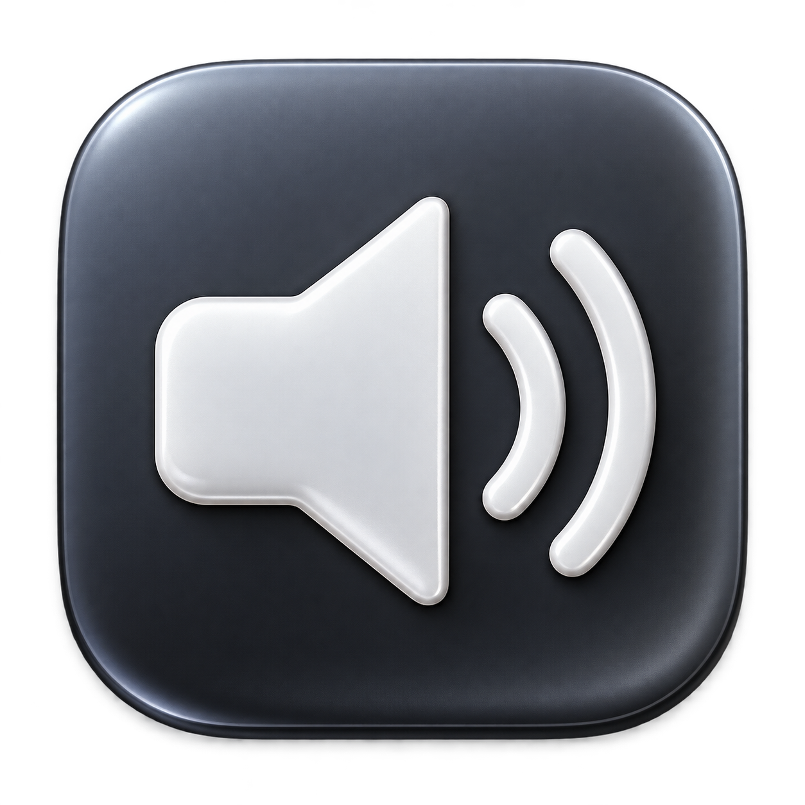

<p align="center">
  
</p>

# SoundVolumeControl — macOS volume control for external monitors

When macOS grays out the volume slider for an external monitor, SoundVolumeControl
lets you use your Mac’s volume keys, mute key, and Control Center to adjust the
monitor’s speakers. The menu bar app lowers the outgoing audio level in software
for fixed-volume HDMI, DisplayPort, and USB-C displays.

[Download the latest macOS installer and SHA-256 checksum](https://github.com/wyzreal/SoundVolumeControl/releases/latest)

Requires **macOS 14 or later on Apple silicon**. The selected output must run
at **48 kHz stereo** for software volume control. Installed playback and hardware
validation are pending for 1.0. [Manual acceptance checklist](docs/manual-acceptance.md)

## Features

- Native macOS volume HUD and smooth volume changes.
- Automatic background routing, output selection, and configurable Start at Login.
- Menu-bar routing status and manual or automatic checks for stable GitHub releases.
- Startup readiness checks and physical output restoration before Quit.
- Output-only audio driver and authenticated, anonymous shared memory.
- No microphone or system-recording APIs.

## Install on macOS

Open the downloaded DMG and run **Install SoundVolumeControl.pkg**.
The installer requests administrator access, installs the matching app, driver,
broker, and signature policy, briefly restarts Core Audio, and opens the app.
The DMG contains ad-hoc-signed components. [Installation guide](docs/user-guide.md#install-from-the-dmg)

The app uses the direct macOS route for devices with native volume control and
starts the helper automatically for supported fixed-volume outputs. Use the
normal macOS volume controls. A green dot reports active Sound Volume routing
in software. Check playback at the display or speakers to confirm audible
output.

Choose **Quit SoundVolumeControl** to restore the physical outputs. To
uninstall, run **Uninstall SoundVolumeControl.command** from the DMG.

## Build from source

Install Xcode Command Line Tools, then run from the repository root:

```sh
make check
make dmg
```

The build writes the matching installer to `dist/SoundVolumeControl-0.9.2.dmg`.

## How it works

```text
Applications → Sound Volume driver → anonymous audio ring
                                    ↓ read-only mapping
                              volume forwarder → physical output
```

The driver publishes the final Core Audio output mix. The forwarder applies a
square-law volume curve and a 5 ms smoothing ramp. A small broker authenticates
the Apple Core Audio host and the exact helper build, then passes a read-only
memory handle to the active console user's helper. The broker never maps PCM.

The virtual format is fixed at 48 kHz stereo, with no general sample-rate
conversion or amplification above unity. Device reconnect, sleep/wake, user
switching, native controls, and sustained playback remain manual acceptance gates.
Automated tests do not establish audible playback or an independent security audit.

## Contributing

The project uses C, Objective-C, system frameworks, and Make; no package manager
is required. Read the [developer guide](docs/development.md), run `make check`,
and include relevant verification with a pull request. For bug reports, include
the macOS/app versions, output device, exact error, and reproduction steps.

- [Architecture and trust boundaries](docs/architecture.md)
- [Menu-bar lifecycle](docs/menu-bar-app.md)
- [Validation coverage](docs/validation.md)
- [Manual acceptance checklist](docs/manual-acceptance.md)
- [Changelog](CHANGELOG.md)

## License

[MIT](LICENSE). No eqMac source or binary code is copied.
